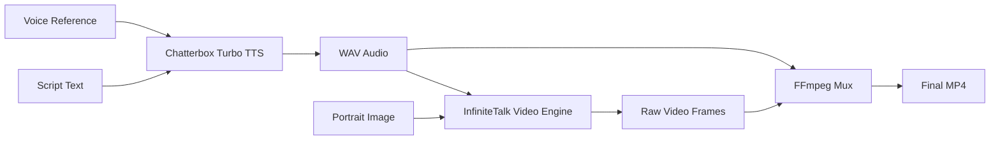
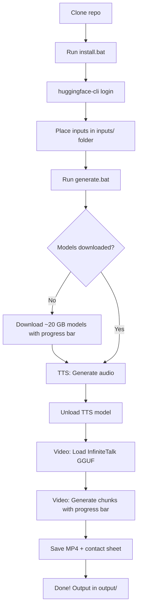
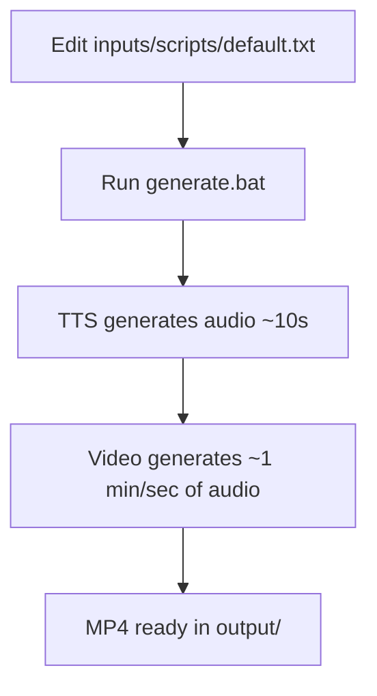

# Talking Head Video Generator — Product Requirements Document

## 1. Overview

### 1.1 Product Summary

A local, CLI-driven application that generates talking-head videos from three inputs: a text script, a voice reference audio clip, and a portrait image. The system clones the voice from the reference, synthesizes speech from the script, and animates the portrait to lip-sync with the generated audio — all running on a single NVIDIA GPU with 16 GB VRAM.

### 1.2 Target User

Content creators, developers, and hobbyists who need talking-head video generation without cloud API costs or privacy concerns. Users are comfortable running CLI tools on Windows.

### 1.3 Key Value Propositions

- **Fully local** — No cloud APIs, no data leaves the machine
- **One-click install** — `install.bat` handles the entire environment setup
- **Zero manual model management** — All ~20 GB of model weights download automatically on first run
- **Voice cloning from ~10s sample** — No training required
- **Any art style** — Photorealistic, cartoon, 3D, illustrated portraits all work
- **Arbitrary aspect ratios** — Follows input image dimensions (not locked to square)

---

## 2. Functional Requirements

### 2.1 Input Requirements

| Input                | Format                                                     | Required    | Default                                                   |
| -------------------- | ---------------------------------------------------------- | ----------- | --------------------------------------------------------- |
| **Script text**      | Plain text file (.txt), inline string, or `--text` CLI arg | Yes         | `inputs/scripts/default.txt`                              |
| **Portrait image**   | PNG, JPG, JPEG, BMP, or WebP                               | Yes         | `inputs/images/default.png`                               |
| **Voice reference**  | WAV or MP3 (>5 seconds)                                    | Recommended | `inputs/voice_ref/default.mp3` (built-in voice if absent) |
| **Animation prompt** | Plain text file (.txt) or inline string                    | No          | `inputs/animation/default.txt`                            |

### 2.2 Output Requirements

| Output            | Format                        | Location              |
| ----------------- | ----------------------------- | --------------------- |
| **Video**         | MP4 (H.264 + AAC) at 25 FPS   | `output/FILENAME.mp4` |
| **Audio**         | WAV at 24 kHz                 | `output/FILENAME.wav` |
| **Contact sheet** | PNG grid of frames (1/sec)    | `output/FILENAME.png` |
| **Debug log**     | Text log (always DEBUG level) | `output/FILENAME.log` |

### 2.3 Functional Capabilities

#### FR-1: Text-to-Speech Generation

- Clone voice from a reference audio clip (>5 seconds)
- Support `[s:N]` tags for inserting silence of N seconds (e.g. `[s:1.5]`, `[s:.5]`)
- Support `${filename}` tags for splicing pre-recorded audio files from `inputs/scripts/` (e.g. `${intro.mp3}`)
- Support `--text "..."` CLI option to pass script text directly instead of reading from file
- Two-level text splitting: lines → sub-sentences (at `.!?` boundaries). Each sub-sentence is a separate TTS call to prevent phantom pauses and truncation.
- Quote stripping: all `"` characters removed before TTS (both ASCII and smart quotes). Quotes are never spoken and cause Chatterbox to malfunction.
- Controlled gaps: 200ms between lines, 100ms between sub-sentences within a line
- Silence trimming on each chunk (leading + trailing) to prevent excess padding
- Output 24 kHz WAV audio
- Support `--audio-only` mode (skip video generation)

#### FR-2: Talking-Head Video Generation

- Generate lip-synced video from portrait image + audio
- Support streaming mode for unlimited-length video (overlapping chunks)
- Video length matches audio length exactly
- Video resolution follows input image aspect ratio
- Support `--video-only` mode (skip TTS, use existing audio)
- Generate contact sheet PNG for quality review

#### FR-3: Pipeline Orchestration

- Sequential GPU usage: TTS fully unloaded before video model loads
- Estimated total time displayed before generation begins
- Rich progress bars for each pipeline stage
- Guaranteed model cleanup on error or interruption (Ctrl+C)
- All output files share a base filename (`--filename` or timestamp) for correlation
- `--filename NAME` CLI param for user-specified output names with auto-increment deduplication

#### FR-4: Model Management

- All model weights (~20 GB) auto-download on first run
- Pre-flight download check with progress bar showing total files and size
- Atomic downloads (temp file → rename) to prevent corruption
- Subsequent runs skip download if files exist

#### FR-5: Installation

- One-click Windows installer (`install.bat`)
- Auto-detect Python 3.10-3.12
- Resolve dependency conflicts between Chatterbox and InfiniteTalk automatically
- Clone patched InfiniteTalk fork ([garystorey/InfiniteTalk](https://github.com/garystorey/InfiniteTalk)) into `vendor/`
- Post-install verification of all critical imports

---

## 3. Non-Functional Requirements

### 3.1 Performance

| Metric                    | Target                       | Measured      |
| ------------------------- | ---------------------------- | ------------- |
| TTS generation            | <20s for ~30-word script     | ~5-18s        |
| Video generation          | ≤1.5 min per second of audio | ~1.46 min/sec |
| Total pipeline (8s video) | <15 min                      | ~14 min       |
| ETA accuracy              | <5% error                    | ~1% error     |

### 3.2 Hardware Requirements

| Requirement    | Minimum                | Recommended                  |
| -------------- | ---------------------- | ---------------------------- |
| **GPU**        | NVIDIA with 16 GB VRAM | RTX 4090 (Desktop or Laptop) |
| **System RAM** | 16 GB                  | 32 GB                        |
| **Disk space** | 30 GB free             | 50 GB free                   |
| **OS**         | Windows 10             | Windows 11                   |

### 3.3 Reliability

- GPU OOM errors caught and reported with actionable message
- Thermal management: auto-pause between chunks if GPU exceeds 70°C
- Graceful handling of KeyboardInterrupt with model cleanup
- Logging always captures full debug output to file for post-run diagnosis

### 3.4 Usability

- Sensible defaults for all parameters — `generate.bat` with zero arguments produces output
- Rich progress bars for all pipeline stages including post-generation (saving video, unloading model, contact sheet generation)
- Clear error messages with suggested fixes

---

## 4. System Architecture

---

## 5. User Workflows

### 5.1 First Run (Full Pipeline)

### 5.2 Subsequent Runs

---

## 6. CLI Interface

### 6.1 Modes

| Mode              | Command                                       | Description               |
| ----------------- | --------------------------------------------- | ------------------------- |
| **Full pipeline** | `generate.bat`                                | TTS → Video → MP4         |
| **Inline text**   | `generate.bat --text "Hello. [s:1] World."`   | TTS from CLI string       |
| **Audio only**    | `generate.bat --audio-only`                   | TTS only, skip video      |
| **Video only**    | `generate.bat --video-only path/to/audio.wav` | Video from existing audio |

### 6.2 Options

| Flag                  | Type        | Default                        | Description                                               |
| --------------------- | ----------- | ------------------------------ | --------------------------------------------------------- |
| `--text STRING`       | string      |                                | Script text for TTS (instead of default.txt)              |
| `--animation TEXT`    | string/file | `inputs/animation/default.txt` | Animation style description                               |
| `--filename NAME`     | string      | `run_YYYYMMDD_HHMMSS`          | Base filename for all outputs (auto-increments)           |
| `--audio-cfg SCALE`   | float       | 1.0                            | Audio guidance scale (2.0 = stronger lip sync, 2× slower) |
| `--blocks-to-swap N`  | int         | auto-tune                      | DiT blocks to swap CPU↔GPU (0-40)                         |
| `--prefetch-blocks N` | int         | 1                              | Async prefetch blocks ahead                               |

---

## 7. Model Dependencies

| Model                     | Size     | Source                                | License    |
| ------------------------- | -------- | ------------------------------------- | ---------- |
| Chatterbox Turbo          | ~700 MB  | ResembleAI/chatterbox-turbo           | MIT        |
| Wan2.1-I2V-14B (VAE+CLIP) | ~5.3 GB  | Wan-AI/Wan2.1-I2V-14B-480P            | Apache 2.0 |
| chinese-wav2vec2-base     | ~360 MB  | TencentGameMate/chinese-wav2vec2-base | MIT        |
| GGUF base Q4_0            | ~10.2 GB | city96/Wan2.1-I2V-14B-480P-gguf       | Apache 2.0 |
| GGUF adapter Q8           | ~2.65 GB | Kijai/WanVideo_comfy_GGUF             | Apache 2.0 |
| LightX2V I2V LoRA         | ~738 MB  | Kijai/WanVideo_comfy                  | Apache 2.0 |

---

## 8. Constraints & Assumptions

- **Windows-primary** — Tested on Windows 11. Linux should work but is untested.
- **Python 3.10** — Required intersection of all package constraints (flash_attn, xformers, spacy-pkuseg).
- **PyTorch 2.4.1+cu121** — Locked by InfiniteTalk + xformers + flash_attn compatibility.
- **Chatterbox `--no-deps`** — Installed without dependencies to avoid conflicts with InfiniteTalk's torch/diffusers versions.
- **HuggingFace auth** — Required for Chatterbox model download.
- **FFmpeg** — Required for audio/video muxing. Auto-detected from PATH or `imageio-ffmpeg`.
- **Sequential GPU** — Only one model on GPU at a time. TTS fully unloads before video.
- **16 GB VRAM minimum** — GGUF model (~12.8 GB) + block swap + activation headroom.

---

## 9. Success Criteria

| Criterion                                                                 | Target | Status       |
| ------------------------------------------------------------------------- | ------ | ------------ |
| Fresh install from git clone works without manual steps (beyond HF login) | Pass   | ✅           |
| First-run model download completes with progress indication               | Pass   | ✅           |
| 8s video generates in <15 min on RTX 4090 Laptop                          | Pass   | ✅ (~14 min) |
| Output video has consistent face/color across chunks                      | Pass   | ✅           |
| Lip sync is visually acceptable                                           | Pass   | ✅           |
| GPU OOM handled gracefully (not a crash)                                  | Pass   | ✅           |
| Ctrl+C cleanly unloads models                                             | Pass   | ✅           |
