# Talking Head Video Generator — Technical Design Document

## 1. System Overview

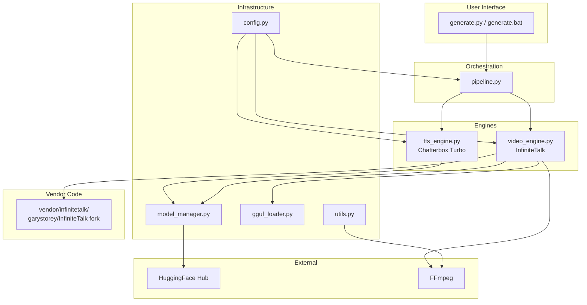

---

## 2. Pipeline Architecture

### 2.1 Full Pipeline Flow

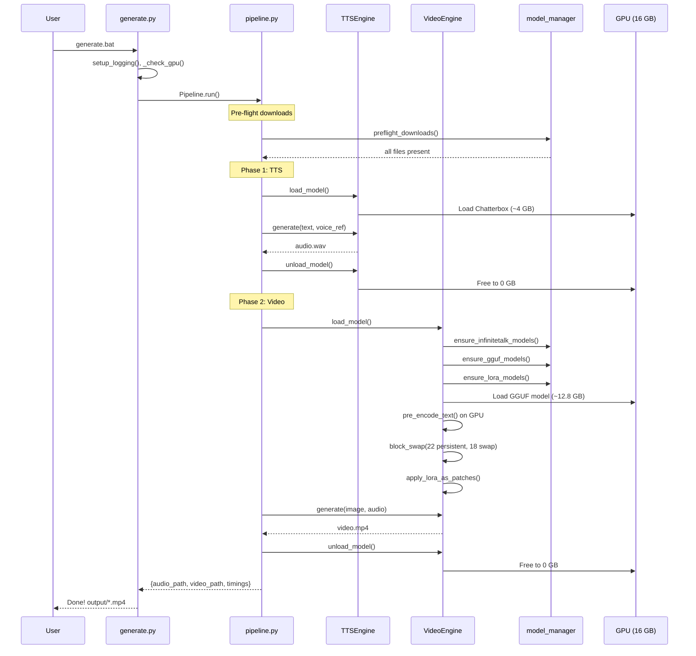

### 2.2 VRAM Timeline

```mermaid
gantt
    title GPU VRAM Usage Over Time
    dateFormat X
    axisFormat %s

    section TTS
    Load Chatterbox (~4 GB)     :a1, 0, 15
    Generate audio              :a2, 15, 25
    Unload (0 GB)               :milestone, m1, 25, 0

    section Video Load
    Load GGUF DiT (~12.8 GB)    :b1, 26, 80
    Pre-encode T5 on GPU        :b2, 80, 90
    Offload VAE/CLIP to CPU     :b3, 90, 95
    Block swap setup            :b4, 95, 100

    section Video Generate
    Chunk 1 denoise (~8.5 GB)   :c1, 100, 240
    Chunk 1 VAE decode          :c2, 240, 268
    Chunk 2 denoise             :c3, 268, 408
    Chunk 2 VAE decode          :c4, 408, 436
    Chunk N...                  :c5, 436, 600

    section Cleanup
    Unload (0 GB)               :milestone, m2, 600, 0
```

---

## 3. Component Design

### 3.1 TTS Engine (`tts_engine.py`)

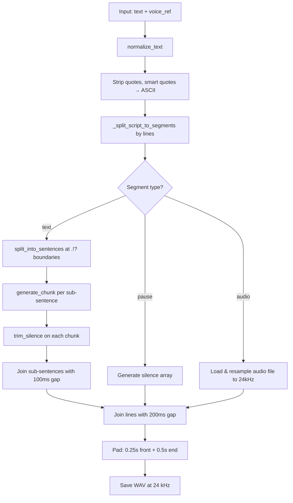

**Key Implementation Details:**

- **Model**: `ChatterboxTurboTTS.from_pretrained(device="cuda")`
- **Voice ref**: Must be >5 seconds. Converted to WAV if MP3.
- **Text normalization**: Smart quotes → ASCII `"` → stripped. Em/en dashes → `-`. Prevents phantom pauses and truncation in Chatterbox.
- **`--text` CLI option**: Pass script text directly instead of reading from `inputs/scripts/default.txt`. Priority: `--text` > file.
- **`[s:N]` pause tags**: Insert N seconds of silence (supports `[s:1.5]`, `[s:.5]`, etc.)
- **`${filename}` audio references**: Splice pre-recorded audio files from `inputs/scripts/` into the output. Files are loaded and resampled to 24kHz.
- **Two-level splitting**: Lines → sub-sentences. Each sub-sentence is a separate TTS call. 100ms gap within lines, 200ms between lines.
- **Silence trimming**: Leading (50ms margin) and trailing (200ms margin) trimmed at -40dB threshold per chunk.
- **Sampling**: `temperature=0.7`, `top_k=150`, `top_p=0.92`, `repetition_penalty=1.2`. Temperature <0.5 causes looping.
- **Output**: 24 kHz mono WAV

### 3.2 Video Engine (`video_engine.py`)

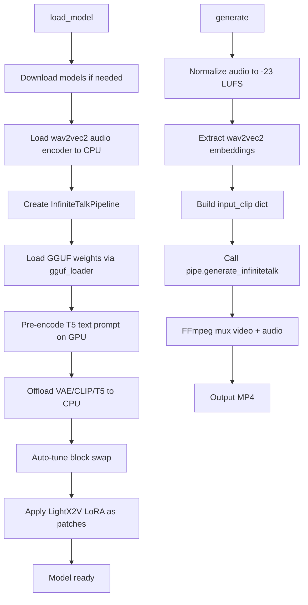

### 3.3 GGUF Loader (`gguf_loader.py`)

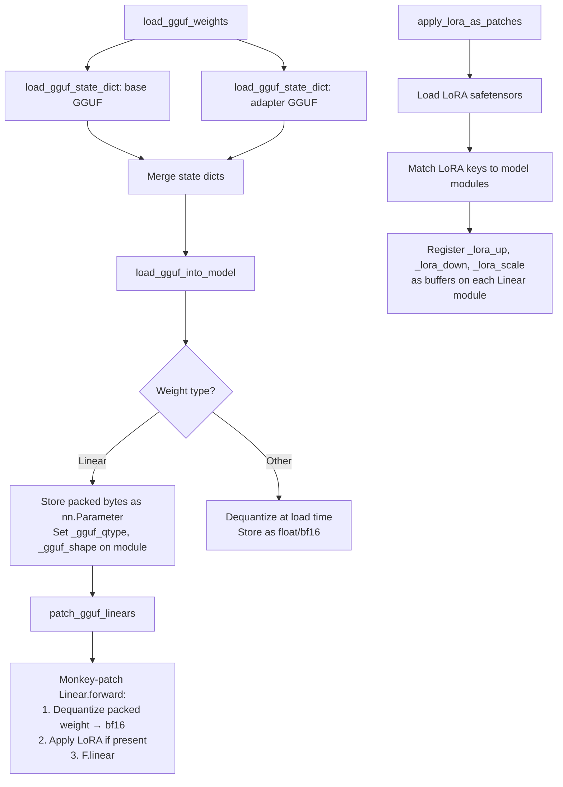

### 3.4 Block Swap Architecture

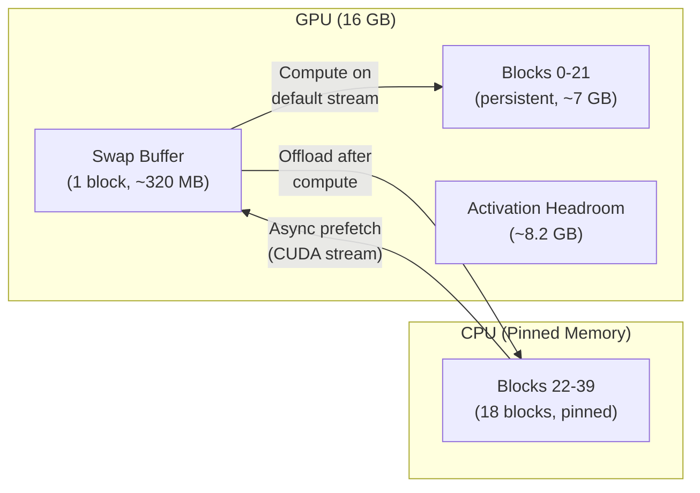

**Block Swap Execution Loop:**

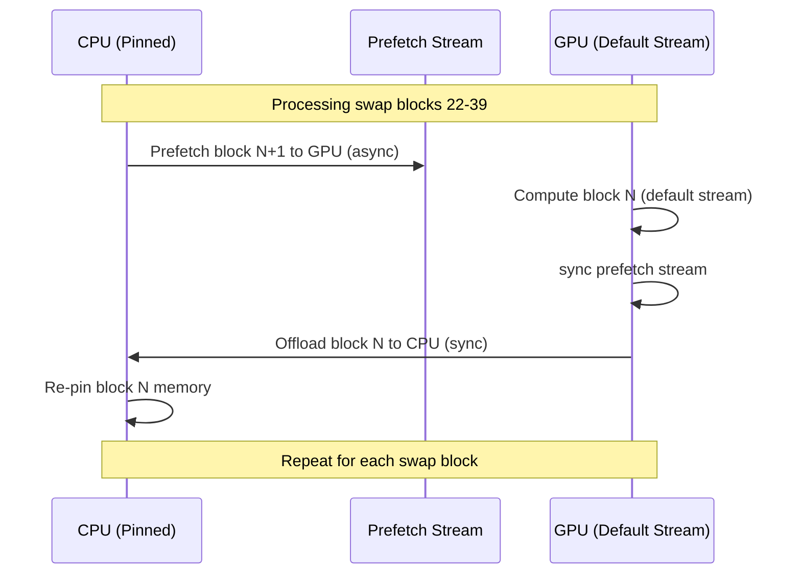

---

## 4. Denoising Loop (Vendor Patch)

### 4.1 DPM++ SDE Solver

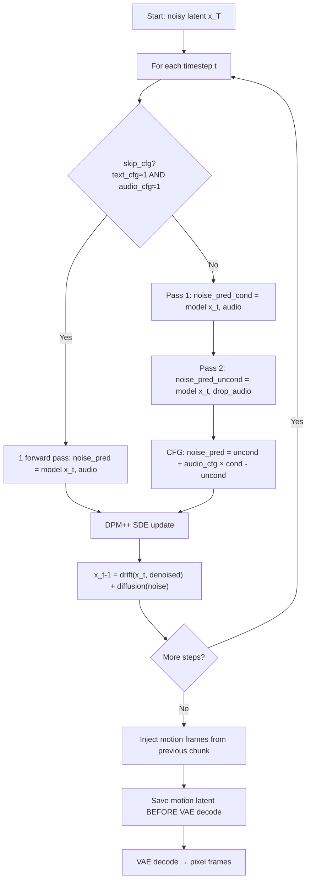

**SDE Update Formula:**

```
alpha_s, alpha_t = 1 - sigma_s, 1 - sigma_t
h = log(alpha_t/sigma_t) - log(alpha_s/sigma_s)
x_t = (sigma_t/sigma_s × exp(-h)) × x_s
    + (alpha_t × (1 - exp(-2h))) × denoised
    + sigma_t × sqrt(1 - exp(-2h)) × noise
```

### 4.2 Streaming Chunk Pipeline

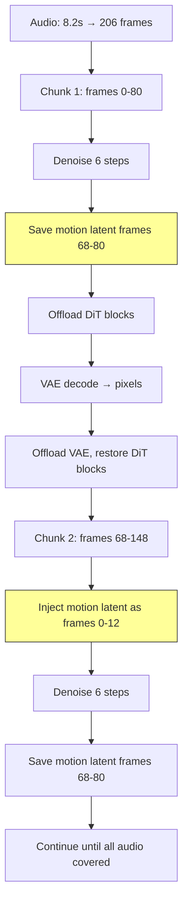

**Key parameters:**

- `frame_num=81` — frames per chunk (4n+1)
- `motion_frame=13` — overlap frames between chunks (0.52s)
- New frames per chunk: 81 - 13 = 68 (2.72s at 25 FPS)
- Direct latent passthrough (no VAE round-trip between chunks)

---

## 5. Installation Architecture

### 5.1 Dependency Resolution

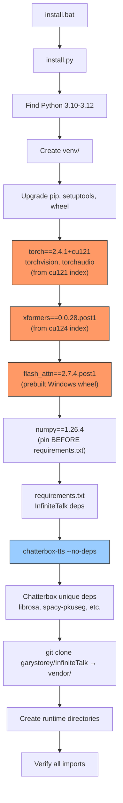

**Critical ordering constraints:**

1. PyTorch must be installed first (cu121 index)
2. xformers from cu124 index (cu121 lacks Windows wheels for torch 2.4.1)
3. numpy pinned before requirements.txt (prevents PyTorch pulling numpy 2.x)
4. Chatterbox with `--no-deps` to avoid torch/diffusers conflicts

### 5.2 Model Download Flow

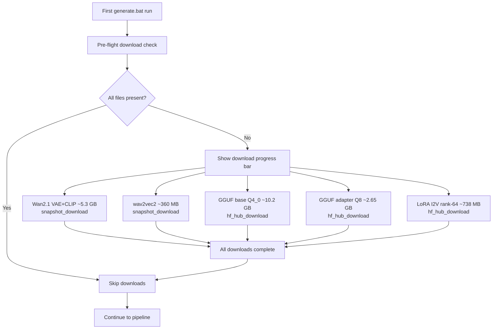

---

## 6. VRAM Management Strategy

### 6.1 Memory Budget (16 GB GPU)

```
┌─────────────────────────────────────────────┐
│                 16 GB VRAM                   │
├─────────────────────────────────────────────┤
│ Persistent DiT blocks (22 × 320 MB) = 7.0 GB│
│ Swap buffer (1 × 320 MB)           = 0.3 GB│
│ Non-block params                    = 0.5 GB│
│ ─────────────────────────────────────────── │
│ Activation headroom                 = 8.2 GB│
│   ├─ GGUF dequant temporaries (bf16)        │
│   ├─ QKV projections                        │
│   ├─ Attention maps                         │
│   └─ FFN intermediates                      │
└─────────────────────────────────────────────┘
```

### 6.2 Critical VRAM Events

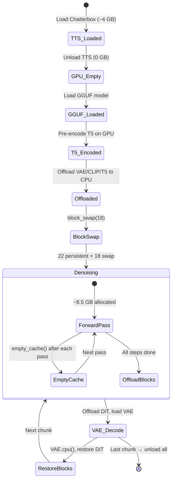

---

## 7. Logging Architecture

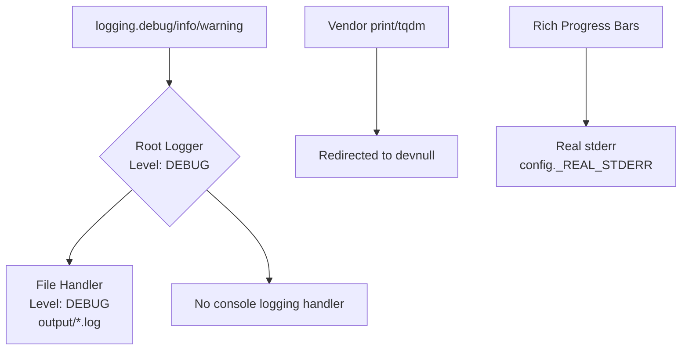

**Key design decision:** Root logger is ALWAYS DEBUG. All debug/info messages go to the log file. Console shows only Rich progress bars — no logging handler is attached to the console. This ensures full diagnostic detail in the log file while keeping the UI clean.

---

## 8. Error Handling

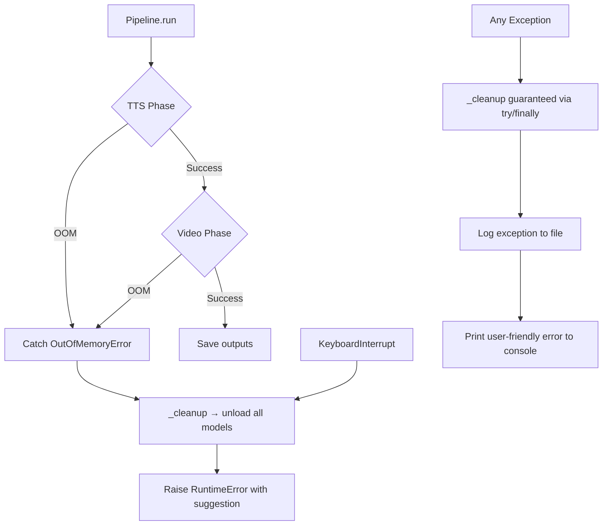

---

## 9. File Dependencies

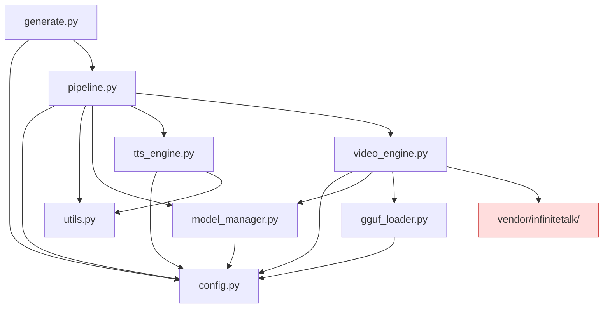

---

## 10. Vendor Patches Summary

Patches maintained in the [garystorey/InfiniteTalk](https://github.com/garystorey/InfiniteTalk) fork. `install.py` clones this fork into `vendor/infinitetalk/` — no post-clone patching needed.

Patches that are **essential** for correct operation:

| File                             | Patch                                             | Purpose                                    |
| -------------------------------- | ------------------------------------------------- | ------------------------------------------ |
| `wan/modules/multitalk_model.py` | `block_swap()`, `_run_blocks_with_swap()`         | Block-level swap with async prefetch       |
| `wan/modules/multitalk_model.py` | `human_num` param in `WanSelfAttention.forward()` | Skip O(n²) attention map for single-person |
| `wan/multitalk.py`               | DPM++ SDE solver implementation                   | Stochastic solver for streaming chunks     |
| `wan/multitalk.py`               | `_skip_cfg` optimization                          | 1 pass/step when both CFG scales ≈ 1.0     |
| `wan/multitalk.py`               | Direct latent passthrough                         | Save motion latent BEFORE VAE decode       |
| `wan/multitalk.py`               | `torch.cuda.empty_cache()` between passes         | Prevent GGUF dequant VRAM fragmentation    |
| `wan/multitalk.py`               | Block offload before VAE decode                   | Free VRAM for 3D transposed convolutions   |
| `wan/multitalk.py`               | VAE offload after decode                          | Free VAE VRAM for next chunk denoising     |
| `wan/multitalk.py`               | Bilinear resize (was nearest)                     | Better interpolation quality               |
| `wan/utils/multitalk_utils.py`   | FFmpeg CRF 10→1                                   | Near-lossless intermediate encoding        |
| `wan/utils/multitalk_utils.py`   | Remove torch_gc() + @torch.compile                | Eliminate hot-path overhead                |
